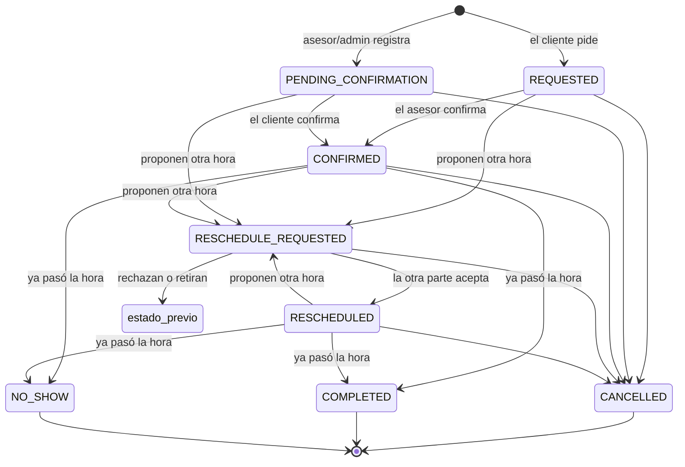

# Máquina de estados de una cita

> Aprobada el 18-sep-2026; se implementa por fases (ver `appointments-architecture.md` §8). Los nombres de estado son los del encargo; en pantalla se muestran en español.

## Estados

| Estado | En pantalla | Activa (ocupa horario) | Significado |
|---|---|---|---|
| `REQUESTED` | Por confirmar | Sí | El **cliente** pidió la visita. Espera al asesor. |
| `PENDING_CONFIRMATION` | Por confirmar | Sí | El **asesor o el admin** la registró (p. ej. por teléfono). Espera al cliente. |
| `CONFIRMED` | Confirmada | Sí | Las dos partes están de acuerdo. |
| `RESCHEDULE_REQUESTED` | Cambio propuesto | Sí (conserva su horario actual) | Una parte propuso otro horario; la otra no ha contestado. |
| `RESCHEDULED` | Reprogramada | Sí | Se aceptó el nuevo horario. Cuenta como confirmada. |
| `CANCELLED` | Cancelada | No | Final. |
| `COMPLETED` | Visitada | No | Final. La visita ocurrió. |
| `NO_SHOW` | No asistió | No | Final. El cliente no llegó. |

> **Interpretación a confirmar:** el encargo lista `REQUESTED` y `PENDING_CONFIRMATION` sin definir la diferencia. Propongo la regla "**confirma quien no la creó**": si la pide el cliente, confirma el asesor; si la registra el asesor/admin, confirma el cliente.

## Diagrama



## Tabla de transiciones

| De | A | Quién | Condiciones |
|---|---|---|---|
| — | `REQUESTED` | Cliente **con cuenta** | Propiedad publicada; horario de los ofrecidos; dentro de la ventana y la anticipación mínima; consentimiento aceptado. |
| — | `PENDING_CONFIRMATION` | Asesor de esa propiedad, admin | Horario libre. Sólo para una **cuenta creada**. |
| — | `CONFIRMED` | Sistema | Sólo si el asesor eligió confirmación automática. |
| `REQUESTED` | `CONFIRMED` | Asesor, admin | Aún no empieza. |
| `PENDING_CONFIRMATION` | `CONFIRMED` | Cliente (panel o enlace de correo) | Aún no empieza. |
| `REQUESTED`, `PENDING_CONFIRMATION`, `CONFIRMED`, `RESCHEDULED` | `RESCHEDULE_REQUESTED` | Cliente, asesor, admin | Aún no empieza; el horario propuesto está libre al proponerlo. Guarda `estado_previo`. |
| `RESCHEDULE_REQUESTED` | `RESCHEDULED` | **La parte que no propuso**, o admin | El horario propuesto sigue libre (se revalida al aceptar). |
| `RESCHEDULE_REQUESTED` | `estado_previo` | La otra parte (rechaza) o quien propuso (retira) | — |
| Cualquier activo | `CANCELLED` | Cliente, asesor, admin | Motivo obligatorio para asesor y admin; opcional para el cliente. |
| `REQUESTED`, `PENDING_CONFIRMATION`, `RESCHEDULE_REQUESTED` | `CANCELLED` | Sistema | La hora de inicio pasó sin respuesta. Motivo "vencida". |
| `CONFIRMED`, `RESCHEDULED` | `COMPLETED` | Asesor, admin | Ya pasó la hora de inicio. |
| `CONFIRMED`, `RESCHEDULED` | `NO_SHOW` | Asesor, admin | Ya pasó la hora de inicio. |
| `COMPLETED` ↔ `NO_SHOW` | — | Admin | Corrección de un error, queda en el historial. |

Todo lo que no está en la tabla se rechaza con 409 y el mensaje de por qué.

## Cómo se garantiza

Una función de Postgres hace cada cambio en **una sola transacción**:

```sql
cita_transicionar(
  p_id uuid, p_version int, p_accion text,
  p_actor_uid text, p_actor_rol text, p_via text,
  p_datos jsonb   -- nuevo horario, motivo…
) returns public.citas
```

1. `select … for update` de la cita.
2. Si `version` no coincide → error "la cita cambió" (la API responde 409 con la cita actual).
3. Busca la acción en la tabla de transiciones (definida **una vez** en `src/lib/citas/estados.ts` y replicada en la función; una prueba compara las dos).
4. Aplica el cambio, `version = version + 1`, `actualizada_en = now()`.
5. Si cambia el horario, recalcula `ocupa_desde/ocupa_hasta`: la restricción de exclusión decide si cabe.
6. Inserta en `citas_eventos`.
7. Marca `revocado_en` en todos los enlaces de acción vigentes de esa cita.

Después, fuera de la transacción: correos, Google y aviso en tiempo real.

## Repetir una acción

- Mismo usuario, misma acción, cita ya en el estado destino (doble clic, reintento de red) → se contesta 200 con la cita, sin repetir correos.
- Otro usuario la cambió antes → 409 con la versión actual y un mensaje claro ("El asesor ya propuso otro horario").

## Historial (`citas_eventos`)

Tipos: `CREATED`, `CONFIRMED`, `RESCHEDULE_PROPOSED`, `RESCHEDULE_ACCEPTED`, `RESCHEDULE_REJECTED`, `RESCHEDULE_WITHDRAWN`, `CANCELLED`, `EXPIRED`, `COMPLETED`, `NO_SHOW`, `CORRECTED`, `NOTE_UPDATED`, `GOOGLE_OUT_OF_SYNC`.

Cada uno guarda quién (`actor_uid`, `actor_rol`), por dónde (`panel`, `correo`, `sistema`, `google`) y el antes/después del horario. Nunca se borra; una cita tampoco se borra, se cancela.
